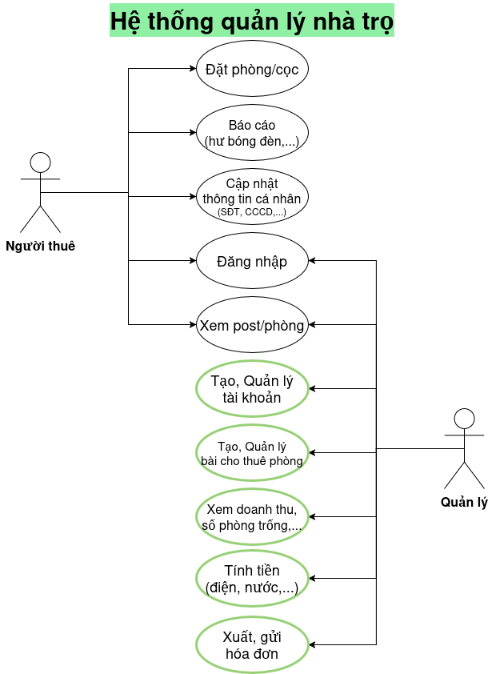

# introductory-capstone
Tranh thủ đợt niên luận cơ sở này, viết để sau này xài luôn =DDD
- [Slides](https://docs.google.com/presentation/d/1ah9UJaAR0LRt9XVeBSRe9aSXfINHvsAoaEpz0z5HbB8)
- [Notes](https://www.notion.so/Ni-n-lu-n-c-s-ng-nh-KHMT-CT201-2e3d7839804a804383d0d76b004c5f2b)
- [Github](https://github.com/wutdahack1337/introductory-capstone)

---
# Hệ thống quản lý nhà trọ
Trong trường hợp phải quản lý số lượng phòng trọ quá lớn, việc quản lý, ghi chép, tính toán truyền thống tỏ ra không còn mấy hiệu quả. Vì lý do đó, hệ thống này được sinh ra nhằm mục đích hỗ trợ, giảm công sức của người quản lý trọ.

**Người có nhu cầu thuê phòng trọ** thì có khả năng kiểm tra, xem phòng, xem giá, đặt cọc. **Người đã thuê trọ** thì sẽ được người quản lý cấp tài khoản, có khả năng báo cáo sự cố (hư bóng đèn,…) và sẽ nhận được hóa đơn cần được thanh toán hàng tháng. Yêu cầu người thuê trọ phải cập nhật thông tin cá nhân một cách đầy đủ và chính xác.

**Người quản lý** sẽ có khả năng tạo, quản lý tài khoản, tạo, sửa bài cho thuê phòng. Xem tổng kết doanh thu tháng, số phòng còn trống. Tính tiền phòng (bao gồm điện, nước, dịch vụ,…) và xuất, gửi hóa đơn cho tài khoản của người đang thuê phòng.

# Yêu cầu
## Chức năng chính

## Phi chức năng
Bảo vệ (mã hóa,...) dữ liệu của người thuê trọ

# Công nghệ
- Frontend: Vue, TypeScript
- Backend: Go
- Database: MongoDB