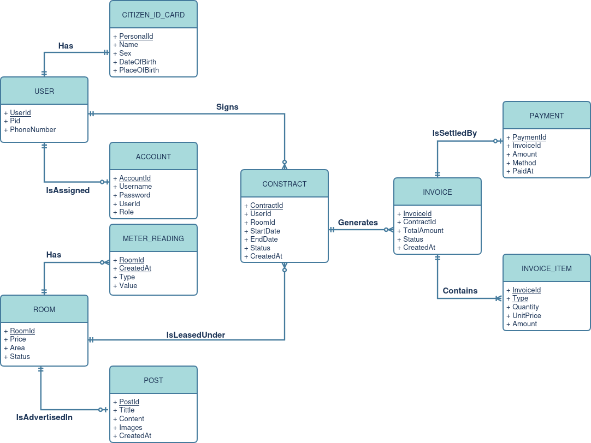

# introductory-capstone
Tranh thủ đợt niên luận cơ sở này, viết để sau này xài luôn =DDD
- [Slides](https://docs.google.com/presentation/d/1ah9UJaAR0LRt9XVeBSRe9aSXfINHvsAoaEpz0z5HbB8)
- [Notes](https://www.notion.so/Ni-n-lu-n-c-s-ng-nh-KHMT-CT201-2e3d7839804a804383d0d76b004c5f2b)
- [Github](https://github.com/wutdahack1337/introductory-capstone)

---
# Hệ thống quản lý nhà trọ
**Một chủ trọ** cần quản lý **dãy nhà trọ** của mình, mỗi phòng chỉ đủ cho **1 người ở**. Một người cùng lúc chỉ có thể thuê 1 phòng. Nhà trọ này chỉ tính tiền phòng, điện và nước, các dịch vụ khác đều là miễn phí. Trong trường hợp phải quản lý số lượng phòng trọ quá lớn, việc quản lý, ghi chép, tính toán truyền thống tỏ ra không còn mấy hiệu quả. Vì lý do đó, hệ thống này được sinh ra nhằm mục đích hỗ trợ, giảm công sức của người quản lý trọ. Hệ thống quản lý nhà trọ cho phép chủ trọ có thể quản lý (thêm, sửa, xóa) phòng trọ, post, người thuê, hợp đồng và hóa đơn. Hệ thống sẽ có *trang tổng hợp số liệu,* ví dụ: số phòng trống, hợp đồng sắp hết hạn,…

Entities chính sẽ là phòng và người thuê.

Mỗi ***người dùng*** có **mã số người dùng**, **số chứng minh nhân dân** (pid - personal id), và **số điện thoại**. Mỗi người ai cũng sẽ có một thẻ ***căn cước công dân*** có **số chứng minh nhân dân**, **họ tên**, **giới tính**, **quê quán** và **ngày tháng năm sinh**. Mỗi người thuê sẽ được chủ trọ tạo và cấp *tài khoản* sau khi kí hợp đồng. Mỗi người sẽ có một ***tài khoản*** có **mã tài khoản, mã người thuê, username**, **mật khẩu** và **role**. Có hai role: *admin* hoặc *tenant* (người thuê nhà, phòng,…).

Khi chưa được cấp tài khoản, người dùng chỉ có thể truy cập được *trang xem phòng, trang này* list ra nhiều phòng, người dùng muốn xem chi tiết phòng nào thì click vào. Sau khi kí hợp đồng và đã được cấp tài khoản, tài khoản sẽ được truy cập thêm vào *trang hóa đơn chưa thanh toán* và *trang thông tin cá nhân*. Người thuê trọ bắt buộc phải nhập thông tin cá nhân. Hàng tháng, người thuê sẽ được thông báo về hóa đơn của mình.

Mỗi ***phòng*** có **mã số phòng**, **giá** thuê mỗi tháng, **diện tích**, và **tình trạng** (đã được thuê chưa). Mỗi phòng sẽ được lưu trữ ***chỉ số điện, nước*** để tính tiền hóa đơn bao gồm **mã số phòng**, **thời gian tạo**, **loại** (điện/nước), và **giá trị**. Mỗi phòng có một bài ***post*** bao gồm **mã bài viết**, **tựa đề**, **mô tả**, **hình ảnh** và **thời gian tạo** được đăng lên *trang xem phòng*. Mỗi phòng chỉ có duy nhất một bài post. Người dùng có thể sử dụng *trang xem phòng,* để tham khảo hình ảnh căn phòng, giá phòng, diện tích và dịch vụ đi kèm,…

***Hợp đồng*** có **mã số hợp đồng**, **mã số người thuê**, **mã phòng, ngày tạo hợp đồng, thời gian bắt đầu, thời gian kết thúc,** và **trạng thái** (còn hiệu lực, hết liệu lực và bị chấm dứt). Thời gian hiệu lực mặc định là 3 tháng hoặc 6 tháng. Khi 1 hợp đồng hết hạn thì người thuê sẽ phải kí tạo hợp đồng mới nếu muốn thuê tiếp tục. Người thuê có thể vào *trang hợp đồng* để xem chi tiết hợp đồng.

***Hóa đơn*** có **mã số hóa đơn**, **mã số hợp đồng, tổng số tiền, ngày tạo** và **trạng thái** (đã thanh toán hay chưa?). ***Chi tiết hóa đơn*** bao gồm **mã số hóa đơn**, **loại** (tiền thuê/tiền điện/tiền nước), **số khối** (điện, nước), **số tiền mỗi khối** và **tổng tiền.** Cứ mỗi tháng, tùy vào ngày tạo hợp đồng, hóa đơn sẽ được tự động tạo mới cho mỗi phòng. Hóa đơn chỉ còn thiếu phần chỉ số điện tháng này và chỉ số nước tháng sẽ được nhập bởi chủ trọ. Sau khi chủ trọ hoàn thành việc nhập chỉ số điện và nước, hóa đơn sẽ tự động tính tổng tiền và gửi hóa đơn vào tài khoản của người thuê (*trang* *hóa đơn chưa thanh toán*).

Người thuê sẽ ***thanh toán***, và hệ thống sẽ lưu trữ gồm **mã thanh toán**, **mã hóa đơn**, **số tiền**, **phương pháp thanh toán** (tiền mặt, chuyển khoản), và **thời gian trả**. Người thuê phải thanh toán đủ tiền.

# ERD

# Công nghệ
- Frontend: Vue, TypeScript
- Backend: Go
- Database: MongoDB
