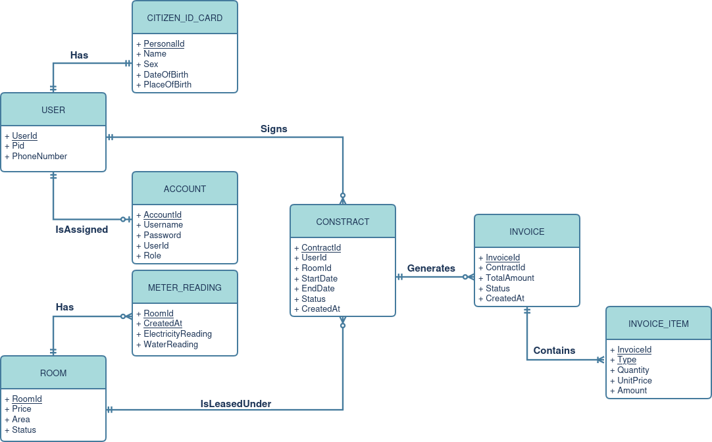

# room_minh_house
Tranh thủ đợt niên luận cơ sở này, viết để sau này xài luôn =DDD
- [Slides](https://docs.google.com/presentation/d/1ah9UJaAR0LRt9XVeBSRe9aSXfINHvsAoaEpz0z5HbB8)
- [Notes](https://www.notion.so/Ni-n-lu-n-c-s-ng-nh-KHMT-CT201-2e3d7839804a804383d0d76b004c5f2b)
- [GitHub](https://github.com/wutdahack1337/room_minh_house)

# Commands

```
curl -o- https://raw.githubusercontent.com/nvm-sh/nvm/v0.40.3/install.sh | bash
source ~/.bashrc
nvm install 20
nvm use 20
npm install

make proto

docker exec -it mongo mongosh

go test ./backend/server -v
go test ./backend/server -v -run TestXYZ
go test ./backend/server -v -run TestXYZ_ABC
```

## Run
```
docker compose up -d
cd backend/cmd && go run . api

cd frontend && npm install && npm run dev
```

---

# Hệ thống quản lý nhà trọ
[Đặc tả hệ thống](ender_chest/documents/Đặc%20tả%20hệ%20thống%20quản%20lý%20phòng%20trọ.docx)

## CDM


## Tech
- Frontend: Vue, TypeScript
- Backend: Go
- Database: MongoDB   

